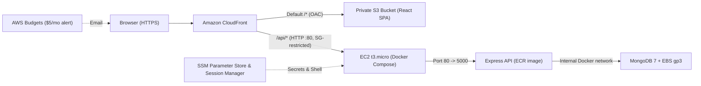

# HabitGraph - Habit Tracker with Streak Visualization (MERN)

> **Course**: Full Stack Application Development (MCA, RVCE)  
> **Repository**: [https://github.com/Indianpatriot/habit-tracker](https://github.com/Indianpatriot/habit-tracker)  
> **Stack**: MongoDB Atlas + Express + React 19 + Node.js 20 (MERN)

HabitGraph is a production-grade full-stack habit tracking application featuring GitHub-style streak heatmaps, gap-and-islands streak calculation with MongoDB aggregation window fields, computed achievement badges, and cross-habit correlation insights built strictly adhering to RVCE MCA course constraints.

---

## Quickstart & Local Setup

### 1. Prerequisites
- **Node.js**: v20+
- **npm**: v9+
- A **MongoDB Atlas** cluster connection URI

### 2. Clone and Install Dependencies
```bash
# Clone the repository
git clone https://github.com/Indianpatriot/habit-tracker.git
cd habit-tracker

# Install server dependencies
cd server
npm install

# Install client dependencies
cd ../client
npm install
cd ..
```

### 3. Configure Environment Variables
Copy `.env.example` to `.env` in both `server/` and `client/`:

**Server Configuration (`server/.env`)**:
```env
PORT=5000
NODE_ENV=development
MONGO_URI=mongodb+srv://<username>:<password>@<cluster>.mongodb.net/habitgraph?retryWrites=true&w=majority
JWT_SECRET=supersecretphase2jwtkey12345678901234567890
CLIENT_ORIGIN=http://localhost:5173
```

**Client Configuration (`client/.env`)**:
```env
VITE_API_URL=http://localhost:5000
```

### 4. Seed the Database
Populate MongoDB Atlas with demo habits and ~90 days of realistic check-in logs:
```bash
cd server
npm run seed
```

**Demo Account Credentials**:
- **Email**: `demo@habit.com`
- **Password**: `demo1234`

### 5. Run the Application
From the repository root:
```bash
npm run dev
```
- **Client (Vite)**: [http://localhost:5173](http://localhost:5173)
- **Server (Express)**: [http://localhost:5000](http://localhost:5000)
- **API Health Check**: [http://localhost:5000/api/health](http://localhost:5000/api/health)

---

## REST API Reference

All protected endpoints require an `Authorization: Bearer <token>` header obtained from `/api/auth/login` or `/api/auth/register`.

### 1. Authentication & Profile (`/api/auth`)
| Method | Endpoint | Access | Description | Status Codes |
|---|---|---|---|---|
| `POST` | `/api/auth/register` | Public | Register new user `{ name, email, password }` | `201`, `400`, `409` |
| `POST` | `/api/auth/login` | Public | Authenticate user `{ email, password }` (Rate limited: 10/15min) | `200`, `400`, `401`, `429` |
| `GET` | `/api/auth/me` | Protected | Get profile of logged-in user `{ _id, name, email, age, picture, createdAt }` | `200`, `401` |
| `PUT` | `/api/auth/me` | Protected | Partial update profile `{ name, age, email, picture }` (300kb limit) | `200`, `400`, `401`, `409` |

### 2. Habits CRUD (`/api/habits`)
| Method | Endpoint | Access | Description | Status Codes |
|---|---|---|---|---|
| `GET` | `/api/habits` | Protected | List user habits (supports `?q=` search), newest first | `200`, `401` |
| `POST` | `/api/habits` | Protected | Create habit `{ name, goalType, targetPerWeek, weekdays }` | `201`, `400`, `409` |
| `GET` | `/api/habits/:id` | Protected | Get single habit details by ID | `200`, `400`, `404` |
| `PUT` | `/api/habits/:id` | Protected | Update/rename habit | `200`, `400`, `404`, `409` |
| `DELETE` | `/api/habits/:id` | Protected | Delete habit and cascade delete all its logs | `204`, `400`, `404` |

### 3. Check-ins, Notes & History (`/api/habits/:id/logs`, `/api/habits/:id/history`)
| Method | Endpoint | Access | Description | Status Codes |
|---|---|---|---|---|
| `POST` | `/api/habits/:id/logs` | Protected | Record completion (optional `{ date, note }`; idempotent upsert) | `200`, `400`, `404` |
| `PATCH`| `/api/habits/:id/logs/:date` | Protected | Edit or clear note on existing log `{ note }` | `200`, `400`, `404` |
| `GET`  | `/api/habits/:id/history` | Protected | Paginated check-in history `?page=1&limit=10` (newest first) | `200`, `400`, `404` |
| `DELETE` | `/api/habits/:id/logs/:date`| Protected | Remove completion for date (idempotent delete) | `200`, `400`, `404` |
| `GET` | `/api/habits/:id/logs?from=&to=` | Protected | List completion log date strings (`["YYYY-MM-DD", ...]`) | `200`, `400`, `404` |

### 4. Analytics & Aggregations (`/api/stats`)
Streaks, heatmaps, and stats are **never stored**; they are derived on-the-fly from logs using MongoDB aggregation pipelines.

| Method | Endpoint | Access | Description | Status Codes |
|---|---|---|---|---|
| `GET` | `/api/stats/heatmap?days=30\|90\|365` | Protected | Range-selectable activity matrix ending today UTC (default 90) | `200`, `400`, `401` |
| `GET` | `/api/stats/activity?days=30\|90\|365` | Protected | Most and least active habits in window with alphabetical tie-breaking | `200`, `400`, `401` |
| `GET` | `/api/stats/week-compare` | Protected | Fair This Week (Mon-today) vs Last Week comparison stats | `200`, `401` |
| `GET` | `/api/habits/:id/stats` | Protected | Habit streak stats `{ currentStreak, longestStreak, last30 }` | `200`, `400`, `404` |
| `GET` | `/api/stats/achievements` | Protected | 25 derived achievement badges across 5 categories | `200`, `401` |
| `GET` | `/api/stats/insights/overview` | Protected | Visual insights data for all 6 SVG dashboard charts | `200`, `401` |
| `GET` | `/api/stats/insights/cross` | Protected | Cross-habit pair matrix, keystone, best pair & correlations | `200`, `401` |

### 5. Badges & Cross-Habit Correlation
| Method | Endpoint | Access | Description | Status Codes |
|---|---|---|---|---|
| `GET` | `/api/badges` | Protected | Computed achievement badges (`first_checkin`, `streak_7_days`, `streak_30_days`, `streak_4_weeks`, `checkins_100`, `comeback`) | `200`, `401` |
| `GET` | `/api/insights/correlation` | Protected | Habit pair correlation & lift metric (`?a=&b=&days=90`) | `200`, `400`, `401` |
| `GET` | `/api/insights/correlations` | Protected | Top correlated habit pairs ranked by lift | `200`, `401` |

---

## Automated Tests & Verification

The test suite runs using Node.js built-in test runner (`node:test`) with **zero external dependencies** and **no MongoDB connection required**, ensuring fast, deterministic offline execution.

### Run Unit Tests
```bash
cd server
npm test
```

### Test Coverage Highlights (77 Unit Tests across 9 Suites)
- **`server/tests/pagination.test.js`**:
  - `parsePagination`: defaults (`page=1`, `limit=10`), valid integers/strings, limit cap (50 allowed, 51 rejected), invalid values (negative, zero, floats, non-numeric).
  - `computeTotalPages`: 0 items $\rightarrow$ 0 pages, exact boundary pages, partial ceiling pages.
- **`server/tests/heatmapRange.test.js`**:
  - `validateHeatmapDays`: validates allowed values (30, 90, 365), default fallback to 90, rejects others.
  - `fillZeroDays`: verifies exact length of 30, 90, and 365 items ending today UTC.
- **`server/tests/weekCompare.test.js`**:
  - `computeWeekCompare`: covers empty logs, only this week (null percent), only last week (-100%), positive growth, ties broken alphabetically, and Monday edge case (1-day fair window).
- **`server/tests/sanitize.test.js`**:
  - `hasDangerousKeys`: detects keys starting with `$` or containing `.` at top level, deeply nested objects, arrays, and complex payloads.
- **`server/tests/profileValidation.test.js`**:
  - Name length (2 to 50 chars), age integer range (10 to 100 or null), email regex format, picture data URL prefix (`png`, `jpeg`, `webp`) and 200,000 char size limit.
- **`server/tests/analytics.test.js`**:
  - Offline tests for streaks gaps-and-islands, 90-day zero filling, and most/least active habit comparisons.
- **`server/tests/achievements.test.js`**:
  - Exactly 25 badges derived across STREAK, VOLUME, HABITS, CONSISTENCY, CROSS-HABIT categories.
- **`server/tests/insightsOverview.test.js`** & **`server/tests/crossInsights.test.js`**:
  - SVG visual calculations and cross-habit co-occurrence matrices.

---

## Continuous Integration (CI)

The GitHub Actions workflow is located at [`.github/workflows/ci.yml`](.github/workflows/ci.yml).
On every `push` and `pull_request` to `main`:
1. Sets up Node.js 20.
2. In `server/`: runs `npm ci` and `npm test` (offline unit tests, no secrets, no MongoDB connection).
3. In `client/`: runs `npm ci` and `npm run build` (Vite production bundle verification).

---

## Cloud deployment (AWS + Terraform)

### Architecture



### Prerequisites
- **AWS CLI** v2 configured with permissions for VPC, EC2, S3, CloudFront, ECR, IAM, SSM, and Budgets
- **Terraform** `>= 1.10`
- **Docker** (with Buildx / Compose v2 plugin)

### Deployment Commands

1. **Configure variables**:
   ```bash
   cd infra
   cp terraform.tfvars.example terraform.tfvars
   # Edit terraform.tfvars and set your real alert_email
   ```
2. **Initialize, plan, and apply**:
   ```bash
   terraform init
   terraform plan -out=tfplan
   terraform apply tfplan
   ```
3. **Deploy backend (build, push to ECR, restart via SSM)**:
   ```bash
   cd ..
   ./scripts/deploy-backend.sh
   ```
4. **Deploy frontend (Vite build, S3 sync, CloudFront invalidation)**:
   ```bash
   ./scripts/deploy-frontend.sh
   ```
5. **Open the application**:
   ```bash
   echo "https://$(terraform -chdir=infra output -raw cloudfront_domain_name)"
   ```
6. **Tear down all cloud resources when done**:
   ```bash
   cd infra
   terraform destroy
   ```

### Estimated Cost Note
> **Note**: Please check the current [AWS Free Tier terms](https://aws.amazon.com/free/) for your account before deploying. Under AWS Free Tier (within eligible limits), `t3.micro`, 20 GB `gp3` EBS, S3 storage, CloudFront data transfer, and ECR storage typically incur minimal or near-zero cost, while an Elastic IP attached to a running instance and minimal SSM/CloudFront requests stay within low single-digit USD/month. A **$5 USD/month** `aws_budgets_budget` alert (at 80% actual and 100% forecasted) is included to notify you early if unexpected usage occurs.

### Design Decisions
- **MongoDB in a container on EC2 instead of DocumentDB or Atlas**: Keeps all compute and storage in one `t3.micro` instance with an encrypted `gp3` EBS volume and zero external database hosting cost or VPC peering/NAT complexity for a student/demo project.
- **Why CloudFront fronts both the frontend and `/api/*`**: Serves the React SPA over HTTPS from a private S3 bucket and proxies `/api/*` on the same domain, eliminating browser CORS issues and keeping the EC2 origin locked down to the CloudFront origin-facing managed prefix list (`com.amazonaws.global.cloudfront.origin-facing`).
- **Why SSM instead of SSH**: Eliminates open port 22, SSH key pairs, and bastion hosts. Both interactive troubleshooting (Session Manager) and automated deployments (`aws ssm send-command` in `deploy-backend.sh`) work through IAM-authenticated SSM endpoints.
- **What I would change for production**:
  - Use a managed database (e.g. MongoDB Atlas or Amazon DocumentDB) with automated backups and multi-AZ failover instead of single-node containerized MongoDB.
  - Terminate TLS on an Application Load Balancer (ACM certificate) in front of private subnets so traffic from CloudFront to the origin is encrypted end-to-end (HTTPS).
  - Move EC2 instances into private subnets behind an ALB + Auto Scaling Group across multiple Availability Zones.
  - Enable Terraform remote state (`infra/backend.tf.example`) with S3 versioning and `use_lockfile = true`.
